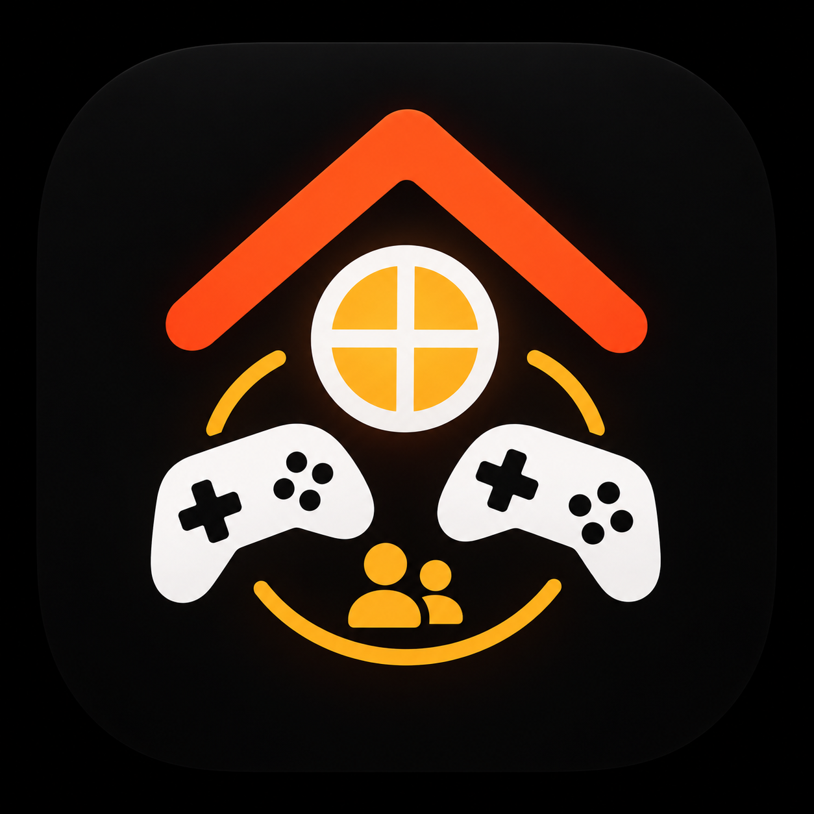

# Attic

Attic is een emulator-app voor de iPhone: je speelt er back-ups mee van spellen die je zelf bezit, voor veertien systemen van vroeger. De app is gratis, bevat geen reclame en verzamelt geen gegevens.

*Attic is an iPhone emulator for backups of games you own. It is free software under the GNU GPL version 3. The app and its documentation are in Dutch.*

## Wat het kan

- **Systemen**: Game Boy, Game Boy Color en Game Boy Advance (mGBA), NES (Nestopia UE), Super Nintendo (bsnes), Nintendo 64 (Mupen64Plus-Next met GLideN64), Nintendo DS (melonDS), Nintendo 3DS (Azahar), GameCube en Wii (Dolphin), PlayStation (PCSX ReARMed), PSP (PPSSPP) en Dreamcast (Flycast). Mega Drive en arcade worden herkend maar draaien nog niet.
- Spellen toevoegen uit Bestanden (ook .zip en .7z), herkennen aan de inhoud, met titels en jaartallen uit de libretro-database en hoesjes van GameTDB en libretro.
- Aanraakknoppen per systeem, staand en liggend, of Bluetooth-controllers (meerdere tegelijk, met eigen knoppenindeling en trillen).
- Save states, terugspoelen, snel vooruit, en AirPlay naar je tv.
- Wii: je iPhone als Wii Remote, met beweging en een aanwijzer die je met je iPhone richt.
- Samen spelen: andere iPhones met Attic in de buurt doen mee als controller.

Attic bevat geen spellen en geen BIOS of firmware van Nintendo, Sony of Sega. Een kleine eigen demo voor de Game Boy Advance zit erin, en in `TestPrograms/` staan eigen testprogramma's voor de andere systemen.

## Bouwen

1. Open `Attic.xcodeproj` in Xcode 26 of nieuwer (iOS 18 of nieuwer).
2. Kies een simulator of je iPhone en druk op Run. Voor een iPhone kies je bij Signing & Capabilities je eigen team en zo nodig een eigen bundle-ID.

De emulators zitten kant-en-klaar in `AtticCores/Frameworks` als XCFrameworks. `Cores/build_cores.py` bouwt ze opnieuw uit de bronnen: per kern een vaste commit van het oorspronkelijke project, met de aanpassingen uit `Cores/patches`. Alles over bouwen, de kernen en hoe de app in elkaar zit, staat in [LEESMIJ.md](LEESMIJ.md).

## Licentie

Copyright © 2026 ILikeLight

Attic is vrije software: je mag het verspreiden en aanpassen onder de voorwaarden van de GNU General Public License, versie 3, zoals gepubliceerd door de Free Software Foundation. Zie [LICENSE](LICENSE).

Attic gebruikt open-source werk van anderen, elk onder zijn eigen licentie (onder meer GPL 2 of later, GPL 3, MPL 2.0, MIT, BSD en Apache 2.0). De spellendatabase `Attic/Resources/GameDB.sqlite` is een bewerking van de [libretro-database](https://github.com/libretro/libretro-database) en valt onder [CC BY-SA 4.0](https://creativecommons.org/licenses/by-sa/4.0/). De licentieteksten staan in [`Attic/Resources/Licenses`](Attic/Resources/Licenses) en in de app onder Instellingen › Emulators en licenties.

### Naam en logo

De naam **Attic** en het **logo van Attic** (`Artwork/attic-logo.png` en het app-icoon in `Attic/Assets.xcassets/AppIcon.appiconset`) vallen niet onder de GPL: alle rechten voorbehouden. Op grond van artikel 7(e) van de GPL 3 geeft de licentie geen recht om de naam of het logo als merk te gebruiken. Verspreid je een aangepaste versie, geef die dan een eigen naam en een eigen icoon. Je mag wel zeggen waar hij vandaan komt, bijvoorbeeld "gebaseerd op Attic".

*The name "Attic" and the Attic logo are not licensed under the GPL (GPL 3, section 7(e)); all rights reserved. Modified versions must use a different name and icon, but may say they are based on Attic.*

Attic is niet verbonden aan Nintendo, Sony, Sega of andere fabrikanten. Namen van systemen zijn merken van hun eigenaars en staan er alleen om aan te geven welke spellen Attic kan spelen.

## Privacy

Zie [PRIVACY.md](PRIVACY.md).
